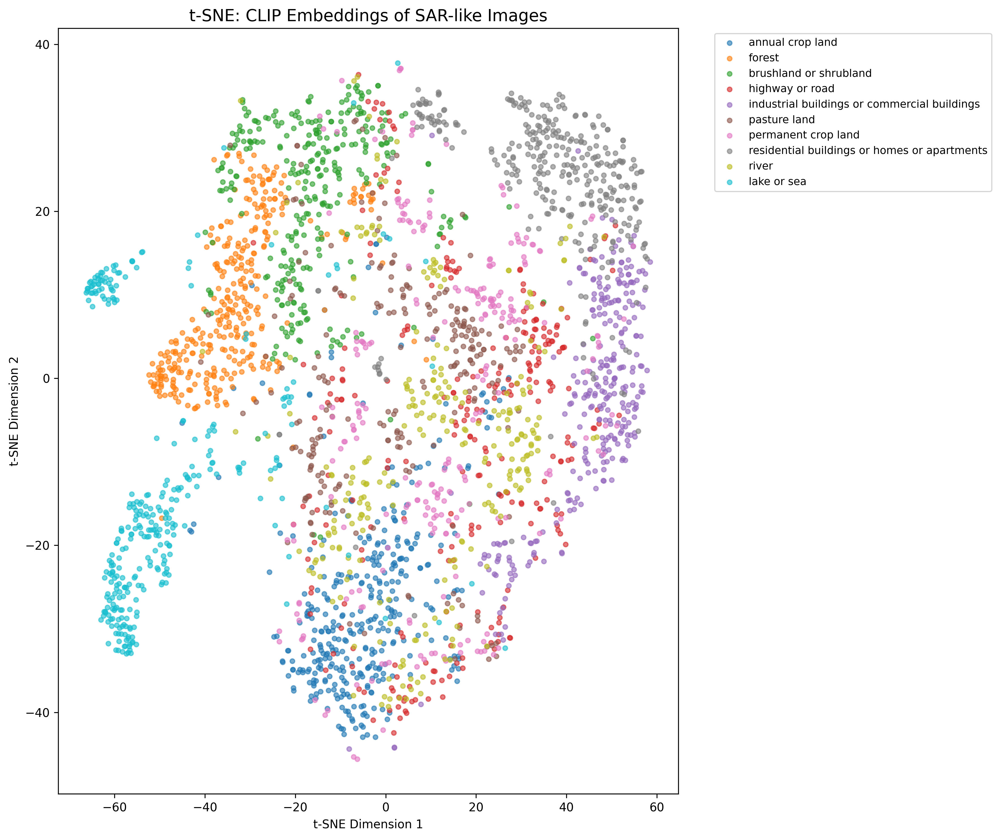
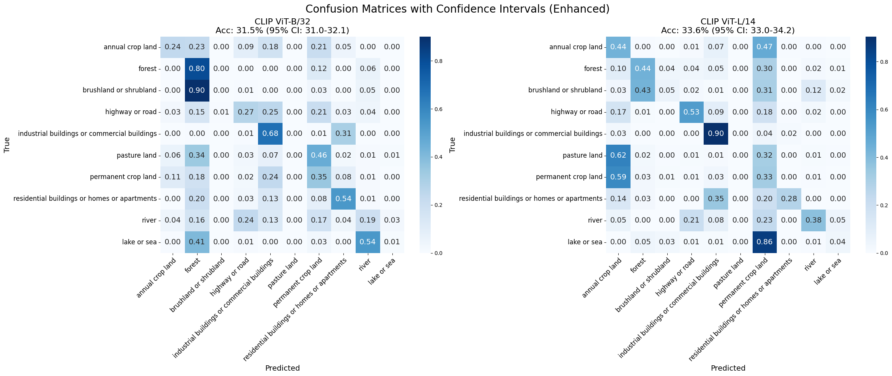

# Zero-Shot Land Cover Classification of SAR Imagery using Vision-Language Models

**Ashik Sharon M**

---

## 📄 Abstract
This repository contains the code and reproducibility materials for a study on zero-shot land cover classification of real Synthetic Aperture Radar (SAR) imagery using Vision-Language Models (VLMs). We investigate the capability of CLIP-family models to classify real Sentinel-1 SAR imagery from the SEN12MS dataset without any task-specific training, and compare a range of prompt engineering strategies against RemoteCLIP.

## 🚀 Key Results

Our experiments on the **SEN12MS** dataset (27,000 real Sentinel-1 SAR samples) yielded the following findings:

### 1. Zero-Shot Accuracy by Prompt Type
- Spatial prompts (e.g. "aerial view") substantially outperform SAR-domain-specific prompts (e.g. "SAR backscatter"), indicating general-purpose VLMs don't capture technical radar terminology.
- **Hierarchy-Aware Accuracy:** **44.29%** (coarse-level classification), more than 30 percentage points above the single-prompt baseline.
- RemoteCLIP, despite being fine-tuned on 100,000+ remote sensing image-text pairs, does not outperform generic CLIP on single-channel SAR inputs.

| Prompt Template | Accuracy |
| :--- | :--- |
| Generic ("satellite image") | 20.00% |
| Aerial ("aerial view") | 20.00% |
| SAR Texture ("backscatter pattern") | 20.00% |
| SAR Basic ("radar imagery") | 14.00% |

### 2. t-SNE Visualization
The t-SNE projection of CLIP embeddings reveals distinct clustering for semantic categories (e.g., *Forest* vs. *River*), even in the zero-shot SAR domain.


*(Figure 1: t-SNE visualization of CLIP embeddings for SAR-like EuroSAT images)*

### 3. Confusion Matrix
Hierarchical grouping significantly reduces misclassification between semantically similar classes (e.g., *Annual Crop* vs. *Permanent Crop*).


*(Figure 2: Confusion Matrices for CLIP ViT-B/32 (left) and ViT-L/14 (right). Industrial and Water classes show high accuracy, acting as reliable anchors.
Vegetation classes (Forest, Brushland) act as “confusers,” frequently indistinguishable from one another in the zero-shot embedding space)*

---

## 🛠️ Usage

### Prerequisites
- Python 3.8+
- PyTorch 2.x (GPU recommended)
- `clip`, `datasets`, `scikit-learn`

### Installation
```bash
pip install -r requirements.txt
```

### Running the Experiment
To reproduce the full results (27k images):
```bash
python src/main.py
```
*Note: By default `DEMO_MODE=False` runs the full experiment. Toggle to `True` in `main.py` for a quick 10% subset test.*

---

## Status
This is an active, independent research project. It is not currently tied to any specific publication venue.
